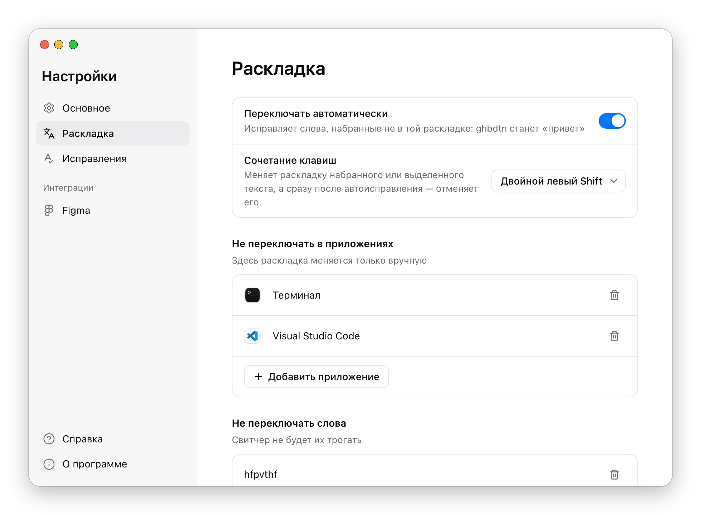
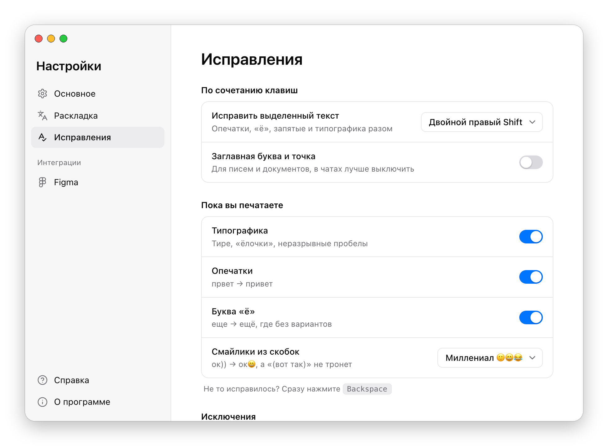

<p align="center"></p>

<h1 align="center">Vallo Switcher</h1>

<p align="center">Забыли переключить раскладку — свитчер исправит сам<br>
Бесплатно, без рекламы, с открытым кодом</p>

<p align="center"><b><a href="https://github.com/madvito-collab/vallo_switcher/releases/latest">⬇ Скачать для macOS</a></b> · <b><a href="https://github.com/madvito-collab/vallo_switcher/releases/download/win-v0.5/ValloSwitcher-win-Setup.exe">⬇ Скачать для Windows</a></b></p>

---

Печатаете `ghbdtn` — получаете «привет». Печатаете `руддщ` — получаете «hello». Не нужно стирать и набирать заново: свитчер замечает ошибку на третьей-четвёртой букве и сам переключает раскладку.

## Что умеет

**Переключает раскладку на лету.** Пока вы печатаете, свитчер понимает, на каком языке слово, и исправляет его. Сленг, айтишные словечки и короткие «ща», «спс», «хз» не трогает.

**Исправляет по сочетанию клавиш.** Дважды нажмите левый Shift:
- сразу после исправления — оно отменится;
- если выделен текст — он переведётся в другую раскладку;
- иначе — переведётся всё, что вы только что набрали.

Если отменить исправление одного и того же слова дважды, свитчер его запомнит и больше трогать не будет.

**Расставляет типографику.** Тире вместо дефиса, «ёлочки» вместо "лапок", неразрывные пробелы, ×, …, ©, →. Прямо во время набора, без отдельных программ. Не понравилось — сразу нажмите Backspace.

**Исправляет опечатки и ставит «ё».** Пропущенную или лишнюю букву, перепутанные буквы, забытый «ь», «кто то» → «кто-то». Двойной правый Shift — и выделенный текст приведён в порядок.

**Ставит запятые.** Если скачать модель запятых (около 230 МБ, кнопка в настройках), двойной правый Shift расставит и их. Модель работает прямо на компьютере.

**Причёсывает макеты в Фигме.** Выделите фреймы и нажмите двойной правый Shift — все тексты внутри пройдут через опечатки, «ё», запятые и типографику. Плагин для Фигмы сейчас на проверке в Figma Community. Как только его одобрят, в настройках появится кнопка «Установить».

Сочетания клавиш можно поменять, а отдельные программы — исключить: по умолчанию свитчер не трогает терминалы и редакторы кода, а также поля паролей, почты, телефонов и ссылок.

<p align="center">
  
  
</p>

## Установка на Мак

Нужна macOS 14 или новее и раскладки «Русская» (или «Русская — ПК») и «ABC» / «U.S.».

1. [Скачайте](https://github.com/madvito-collab/vallo_switcher/releases/latest) файл `Vallo-Switcher-<версия>.dmg` (на странице — раздел «Assets»).
2. Откройте его и перетащите **Vallo Switcher** в папку **«Программы»**.
3. Запустите свитчер. При первом запуске macOS скажет, что не может проверить разработчика: откройте **Системные настройки → Конфиденциальность и безопасность** и нажмите **«Всё равно открыть»**. Так нужно один раз.
4. Свитчер попросит два разрешения: «Универсальный доступ» и «Мониторинг ввода». Без них он не видит, что вы печатаете.

Готово: в строке меню у часов появится значок «ё». Подробная инструкция с картинками — файл «Как установить.pdf» внутри `.dmg`.

Свитчер обновляется сам. Когда выйдет новая версия, на значке появится красная точка, а в меню — кнопка «Обновить».

<details>
<summary>macOS не даёт открыть свитчер — что делать?</summary>

У свитчера нет платной подписи Apple, поэтому macOS осторожничает. Если кнопки «Всё равно открыть» нет, выполните в Терминале:

```bash
xattr -dr com.apple.quarantine "/Applications/Vallo Switcher.app"
```
</details>

<details>
<summary>У меня версия 0.5 или старше</summary>

Автообновление появилось в версии 0.6. Скачайте новую версию один раз вручную и замените старую в «Программах» — дальше свитчер будет обновляться сам.
</details>

## Установка на Windows

Версия для Windows умеет то же, что на Маке: переключать раскладку, исправлять опечатки, ставить «ё» и запятые, расставлять типографику, оформлять телефоны и числа, превращать скобки в смайлики. Плагин для Фигмы пока только на Маке.

1. [Скачайте](https://github.com/madvito-collab/vallo_switcher/releases/download/win-v0.5/ValloSwitcher-win-Setup.exe) `ValloSwitcher-win-Setup.exe` и запустите.
2. Windows может предупредить, что программа незнакомая: нажмите **«Подробнее» → «Выполнить в любом случае»**. Так нужно один раз.

Готово: в трее у часов появится значок «ё». Свитчер запускается вместе с Windows и обновляется сам. Удалить его можно в «Параметры → Приложения».

## Частые вопросы

**Это безопасно? Свитчер видит всё, что я печатаю.**
Видит, но никуда не сохраняет и не отправляет. Всё работает без интернета. В сеть свитчер ходит, только чтобы проверить обновления раз в день и скачать модель запятых, если вы нажмёте кнопку. Код открыт — любой может проверить.

**Сколько стоит?**
Нисколько. Свитчер бесплатный, без рекламы и подписок.

**Свитчер исправил то, что не надо.**
Не та раскладка — сразу нажмите дважды левый Shift. Не та опечатка или типографика — сразу нажмите Backspace. Исправление отменится. Чтобы свитчер больше не трогал слово, добавьте его в настройках: «Настройки → Раскладка» или «Настройки → Исправления».

**Мешает в какой-то программе.**
Добавьте её в исключения: «Настройки → Раскладка» или «Настройки → Исправления».

**А другие языки?**
Пока только русский и английский. Остальные раскладки свитчер не трогает.

**А что умеет версия для Windows?**
То же, что на Маке: раскладка, опечатки, «ё», запятые, типографика, телефоны и числа, смайлики из скобок. Плагин для Фигмы пока только на Маке.

## Нашли ошибку или есть идея?

Напишите в [Issues](https://github.com/madvito-collab/vallo_switcher/issues) — расскажите, что делали и что пошло не так. Скриншот очень поможет.

## Для разработчиков

Как собрать и как всё устроено — в [docs/DEVELOPMENT.md](docs/DEVELOPMENT.md).

Код — под лицензией [MIT](LICENSE): можно брать и дорабатывать, сохранив имя автора. Словари — под своими лицензиями, см. [Data/wordlists/README.md](Data/wordlists/README.md).
